# Verification — 2026-10-30

## alpha.5 — localization and English gallery

All 12 target JARs build and pass packaged dedicated-server start/save/stop checks. Common JUnit: **14 passed**. The translation contract checks all 15 JSON bundles for identical keys, nonempty strings, replacement characters and matching argument placeholders.

Minecraft 1.21.1 was checked graphically in English, Korean, German and Japanese. Latin (not bundled) was checked for English mod-label fallback alongside Latin vanilla titles. All were switched in the same connected session: unlocked and locked names, descriptions, buttons, progress and tooltips updated without reconnecting. Other bundled languages have resource validation, not a completed graphical/native-speaker review. Other Minecraft client versions were not graphically retested for alpha.5.

Vanilla advancement names/descriptions stay as translatable components until rendering. Default server notifications preserve the title component for client localization; existing custom notification templates are retained. Button widths follow translated labels. GUI scales 3/4 and maximized layouts were exercised.

English gallery images are original F2 captures from a separate 1.21.1 demonstration world with three offline test profiles and seven command-earned display advancements. Screenshots contain the real UI and attribution; no generated gameplay or upscaling. The native close-up and collection are 1920×1080; the maximized timeline retains its original resolution.

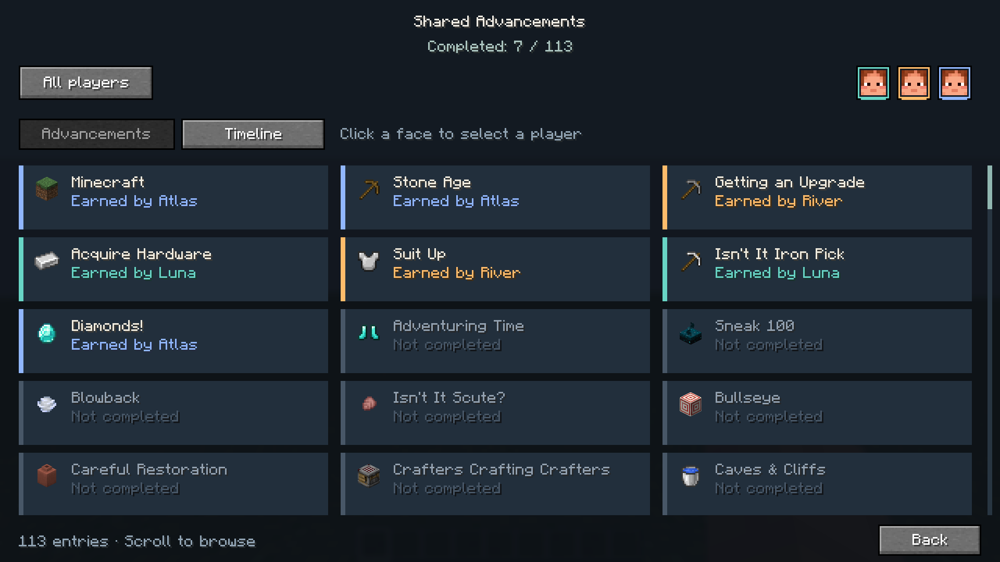
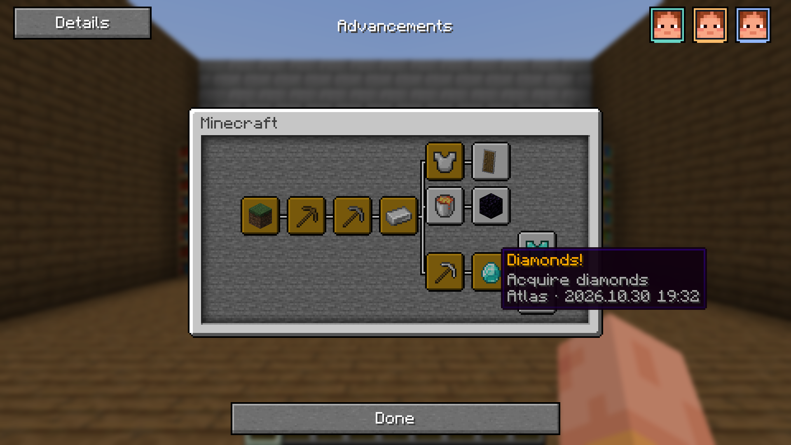
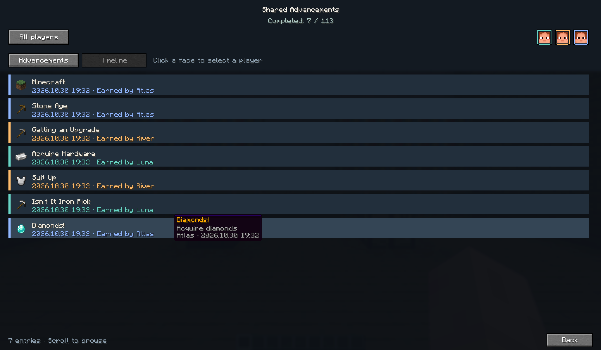

Language evidence: [German](evidence/1.21.1-alpha5-de.png), [Japanese](evidence/1.21.1-alpha5-ja.png), [Korean](evidence/1.21.1-alpha5-ko.png), [Latin fallback](evidence/1.21.1-alpha5-fallback-la.png).

## alpha.4 — resize and interrupted bulk awards

Fixed repeated initialization of vanilla advancement screens: resize retains vanilla widgets, so this mod now removes its own previous widgets by weak identity before adding replacements. Unused face buttons start hidden. Real 1.21.1 window maximize/restore/maximize checks show one Details button and exactly three populated face buttons, with no empty rectangles. The extra shared-completion sentence was removed from tooltips.

A live `advancement grant ... everything` exposed Windows AccessDeniedException during atomic history replacement. The exception previously propagated through the vanilla award callback and interrupted the command. File replacement now retries brief access denials; failed saves remain dirty in server memory, retry after one second and flush again on shutdown, without aborting vanilla awards. Permanent errors remain visible in server logs.

Regression: deliberately held history.json open with FileShare.None during `grant SharedUiTest everything`. The command completed under the lock, then the ledger saved after release. Compared the persisted player advancement file against all 1.21.1 definitions in the Minecraft JAR: **1,399 / 1,399 complete; 122 / 122 display advancements recorded; zero missing**. A previously failed pending record was recovered conservatively after verifying it was a strict superset, with originals preserved.

Common JUnit: **13 passed**, including transient lock retry and bounded permanent failure. All 12 alpha.4 targets compile and pass packaged dedicated-server start/save/stop checks. Exact alpha.4 resize/bulk regression testing was performed on 1.21.1. Earlier alpha.3 graphical evidence for 26.3 is retained below; other client versions remain experimental.

Local bulk evidence: `.tools/refined/grant-everything-alpha4.json`. Expected injected-lock errors in the test server log are followed by successful save recovery.

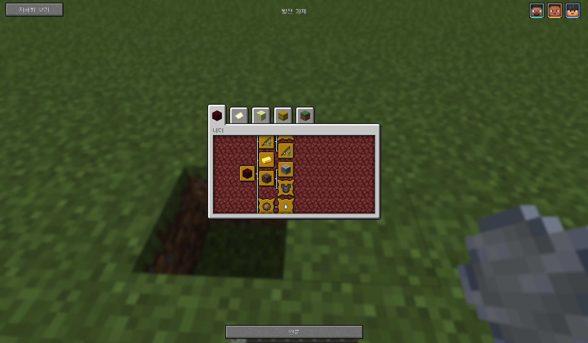
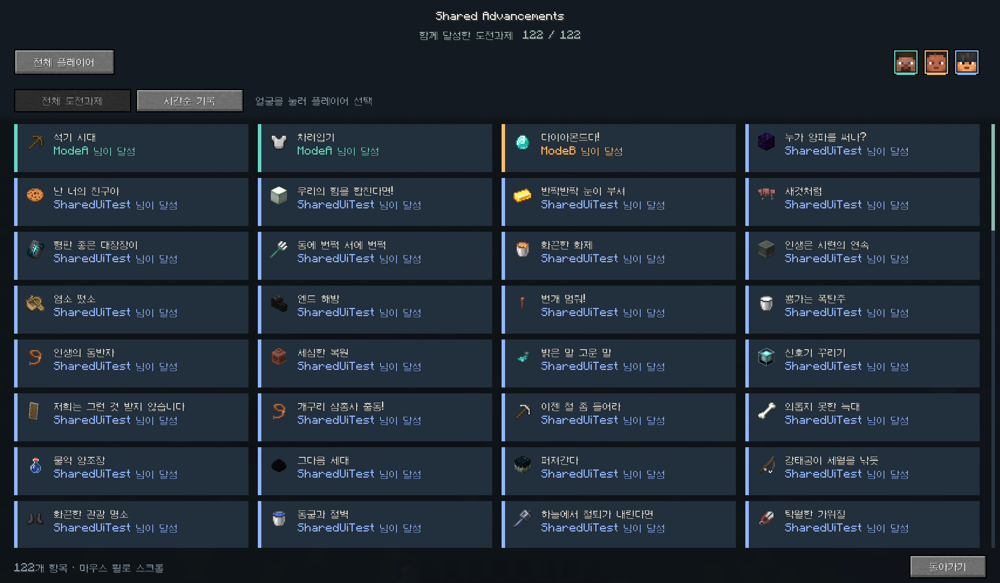

## alpha.3 — always shared, actual achievers, direct UI

All 12 final target JARs compiled and passed dedicated-server startup/save/shutdown smoke tests. Common JUnit: 11 passed, including permanent schema-1 backup, conservative attribution migration, unique advancement grouping, chronological order and personal credit filtering.

The fresh 1.21.1 loopback regression passed 12 checks. It verifies unconditional sharing in both directions, an inventory-triggered diamond achievement, offline catch-up, reconnect, exactly one verified source credit per advancement, schema 2 and absence of a mode setting. After restarting the server, the graphical client received shared unlocks without creating recipient credits. Source history remained three records after repeated reconnects.

Real graphical checks:

- **1.21.1:** vanilla completion state, right-aligned colored face legend, native tooltip above the vanilla window, localized title/description/icon catalog, collection cards, direct face filter, chronological timeline, wheel scrolling and return navigation.
- **26.3:** seeded the same three source records into a separate test world; verified catch-up, a new real server award and source credit, extraction-based card UI, native tooltip and face filtering. This was a one-graphical-client check, not a two-client network test for 26.3.
- Other ten client versions remain unverified visually. Build/server smoke does not certify all gameplay or skin rendering.

The visual test caught two issues fixed before these captures: Screen background blur covering custom content, and tooltip depth behind the vanilla advancement window. Native immediate/deferred/extraction tooltip adapters resolve the latter. Catalog payloads include icon IDs and translation keys so locked entries retain their actual icons and localized labels.

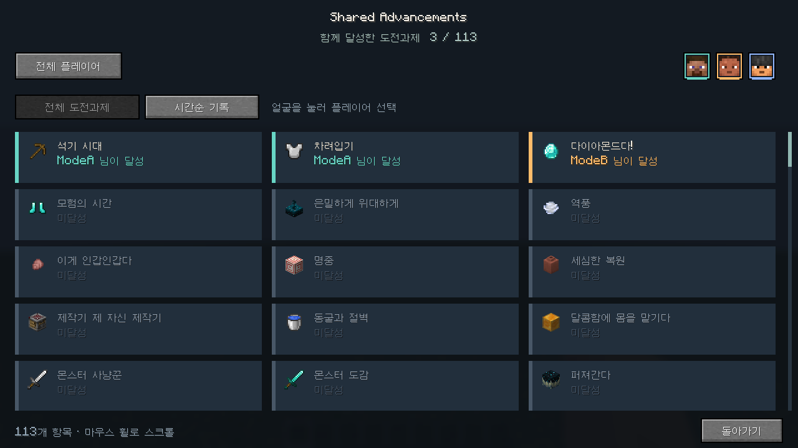
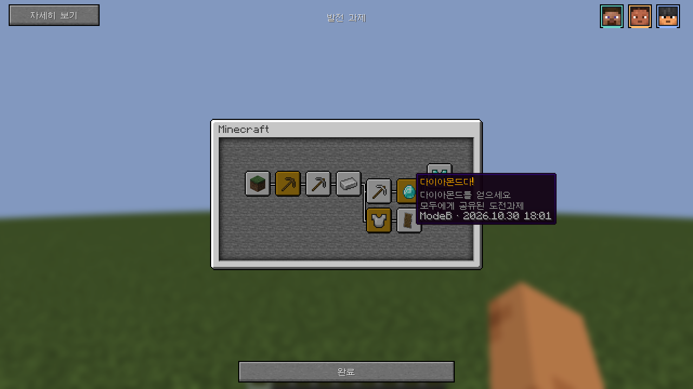
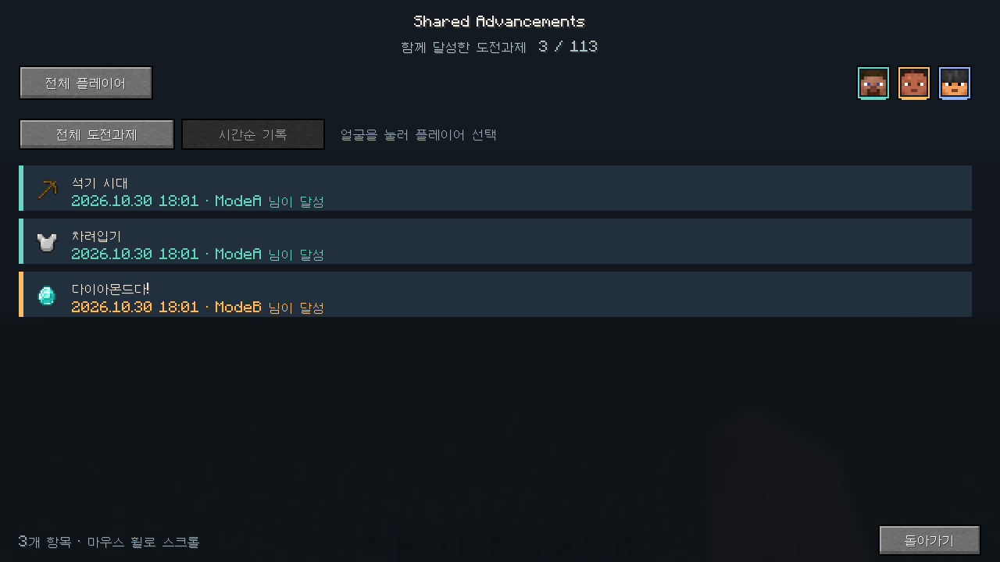
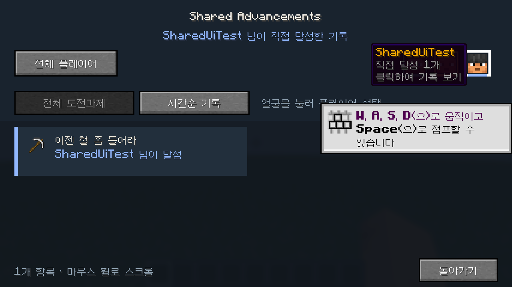

Local evidence: `.tools/refined/sharing-test.log`, `.tools/refined/alpha3/sharing-test.json`, separate server ledgers/logs in `.tools/refined/alpha3` and `.tools/refined/26.3`. Protocol clients still emit the third-party recipe parser warning; assertions inspect actual vanilla server state and persisted source credits. Test names are synthetic. Existing player worlds were not reset.

## alpha.2 — selectable sharing modes

All 12 targets rebuilt successfully and all 12 packaged dedicated servers passed startup/save/shutdown smoke tests with alpha.2. Common JUnit: 10 tests passed. Graphical and cooperative gameplay checks below were performed on 1.21.1; other versions' new mode behavior has not been graphically certified.

The disposable two-player test in `scripts/test-sharing.cjs` passed 11 assertions: individual owner unlock with the other player still locked; cooperative historical catch-up and live sharing; offline completion/rejoin catch-up; switching back stops new sharing without revoking existing unlocks; re-enabling catches up; original first achiever and persistent mode file remain correct. A JOIN-before-PlayerList-insertion bug was found by this test and fixed by explicitly including the joining player.

After a clean server restart, a real Minecraft 1.21.1 client joined in Co-op mode and received prior unlocks. A test command granted only `SharedTestA` the Diamonds! advancement; the mod then awarded `SharedTestB` and graphical client `SharedUiTest`. Both vanilla completion messages and the Shared Co-op screen were inspected. This is a command-triggered real game demonstration, not footage of manually mining diamonds.

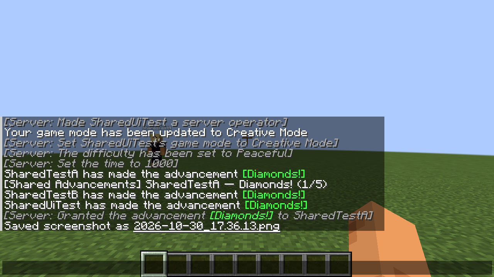

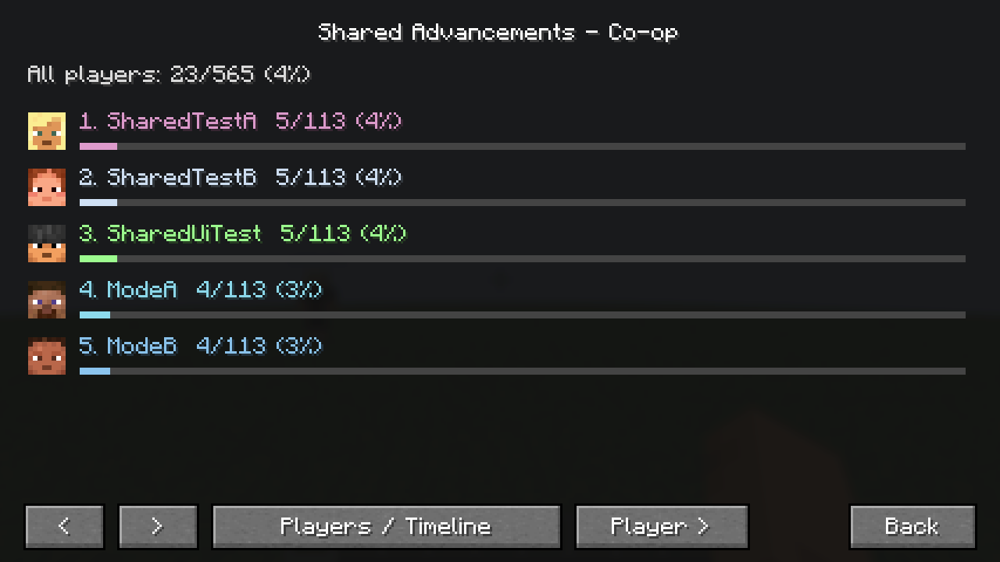

Local mode evidence: `.tools/modes/1.21.1/sharing-test.json`, `.tools/modes/sharing-test.log`, and the restarted server's `console.log`. Only synthetic test players were used.

## alpha.1 baseline

[GitHub Actions run 41024888865](https://github.com/jomebe/Shared-Advancements/actions/runs/41024888865) passed all 12 build/test/packaged-server jobs for implementation commit `c85667b`. The following evidence predates selectable modes.

## Local evidence

| Scope | Result |
| --- | --- |
| All 12 target dependency manifests | Release entries, Java version and Fabric API artifacts verified |
| All 12 target JAR builds | Passed; exact-version Fabric metadata |
| All 12 packaged JAR dedicated servers | Started, loaded `shared_advancements`, saved, stopped successfully on Java 21 / 25 as appropriate |
| Common JUnit tests | 7 passed |
| 1.21.1 two protocol clients | Each received both players' actual completion packets |
| 1.21.1 duplicate + revoke/re-award | One record per UUID/ID; original timestamp unchanged |
| 1.21.1 offline + clean restart + reconnect | Both persisted player histories synchronized again |
| 1.21.1 graphical client | Vanilla screen, Shared button, player faces/colors/progress, timeline, first achiever, per-player filter and return navigation verified |
| 1.21.1 integrated singleplayer | New world loaded, completion detected, notification shown, world-local ledger saved with only its own player |
| 26.3 graphical multiplayer client | Loaded, received completions, rendered vanilla hover panel and Shared player face/progress screen |
| Other versions' graphical clients | Not yet verified; server smoke is not client compatibility certification |

Synthetic players `SharedTestA`, `SharedTestB`, `SharedUiTest` were used only on a loopback test server. The protocol probe had a third-party recipe-packet parsing warning; its custom history messages were received and compared with the saved server ledger. It is not treated as evidence of a full graphical client.

The Minecraft client run revealed and fixed a button overlap with vanilla's Done footer. Concurrent development execution revealed that reusing the Gradle project path `:fabric` across targets lets output cleanup remove another target's development classes. Each target now uses a unique project path (`:fabric-1.21.1`, etc.). Packaged mod classes are included in the JAR.

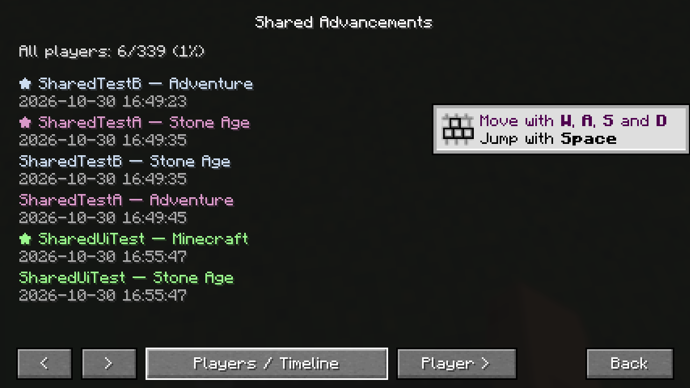

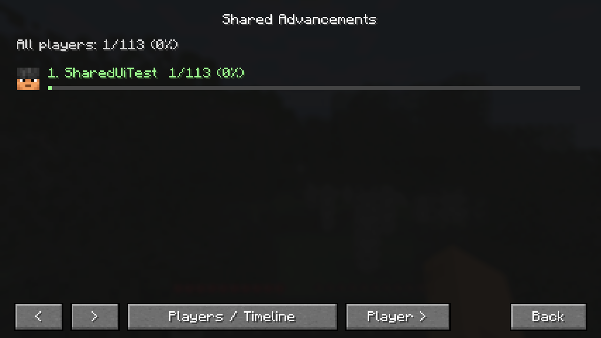

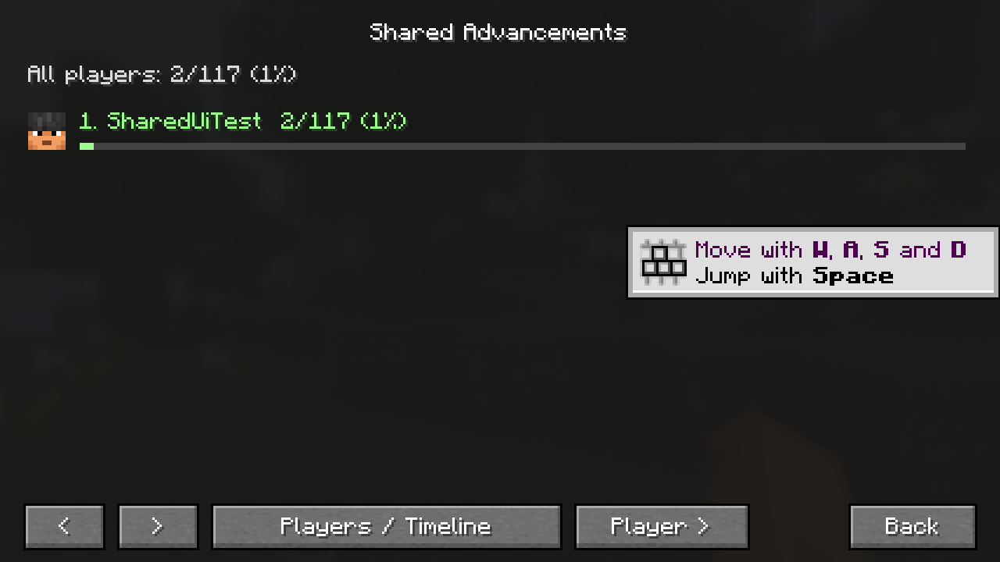

Raw local build logs: `build/matrix/<version>.log`.
Raw local dedicated server logs: `.tools/smoke/<version>/smoke.log`.
These ignored logs contain local environment paths and are not published verbatim. CI retains its own logs and test reports.

## Remaining release qualification

The full [checklist](TESTING.md) remains required before calling an exact version fully supported. In particular, intermediate-version client rendering, all GUI scales, authenticated custom skins, large servers and arbitrary third-party datapacks have not been certified. Offline/unavailable skins may use vanilla default faces. No Modrinth/CurseForge version compatibility is claimed or published by this repository.

Modrinth publication was explicitly deferred by the owner. Build artifacts are development alpha candidates, not a stable release.
